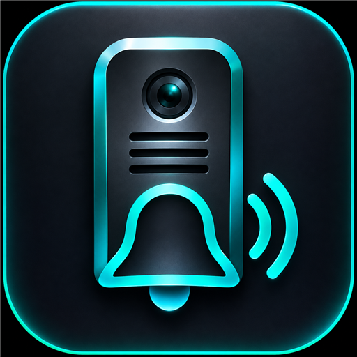

# Hikvision Intercom

<p align="center"></p>

One Home Assistant integration for a Hikvision / Hik-Connect video intercom, plus one
small app for the part that needs Hikvision's SDK:

| What | How |
|---|---|
| Door unlock, answer / hang up, volumes, do-not-disturb, call status, ring event | Hik-Connect cloud (no phone app needed) |
| Live camera | Directly from the station over your LAN |
| Custom doorbell chime on the indoor screen | Local SDK connection, through the **Hikvision SDK Bridge** app |

It replaces three integrations (`hikconnect`, `hikconnect_intercom`,
`hikvision_intercom_chime`), the *Hikvision Doorbell* app and the MQTT broker that
only they needed. Windows, iVMS, SADP and the Hik-Connect phone app are not required.

**HACS custom repository** (not submitted to the default catalogue).
[Türkçe kurulum rehberi](docs/KURULUM_TR.md).

## Requirements

- Home Assistant 2026.10.0 or later.
- A Hik-Connect account that owns the station.
- For the chime only: Home Assistant OS or Supervised (it needs apps), and the station's
  private IPv4 address, SDK port (normally 8000) and **device admin** password (not the
  Hik-Connect password).

## Install

1. HACS -> three-dot menu -> Custom repositories -> add
   `https://github.com/berkkayhan34-sys/hikvision-intercom-chime`, category **Integration**
   -> download **Hikvision Intercom** -> restart Home Assistant.
2. Settings -> Devices & services -> Add integration -> **Hikvision Intercom** -> sign in
   with your Hik-Connect account. Door, camera, calls and volumes work from here.
3. Chime only: Settings -> Apps -> App store -> three-dot menu -> Repositories -> add the same
   URL -> install **Hikvision SDK Bridge** (the image is built on your device; the first
   build downloads about 26 MB) -> start it.
4. On the integration page choose **Add local station** and enter the station's address, SDK
   port and admin credentials. Confirm the app restart. The password is stored only in the
   app's own options; the integration entry never contains it.

## Entities

Per Hik-Connect station: answer / hang up / unlock buttons, lock, camera, call status,
last ring, doorbell event, ringtone / two-way / microphone volumes, do-not-disturb and
status sensors. Per local station (named when you add it):

- **Play chime** - send the selected sound with the selected gain and repetitions.
- **Stop chime** - stop only this integration's own playback.
- **Digital gain** (-30..+30 dB) and **Repetitions** (1..10, at most 60 s in total).
  Changing either is silent and applies to the next press.
- **Request status** - idle / sending / error. *Sending* means the request was accepted,
  not that sound was heard.

Removing a local station deletes its uploaded sounds and removes its credentials from the
app's options (this restarts the app). Playback is refused while the station is ringing
or in a call. Nothing is ever played on
setup, reload, upload, or when a setting changes.

Default sound: a two-second ding-dong, four repetitions, 0 dB. Your own sound: station ->
configure icon on the station entry -> **Reconfigure** -> upload a WAV, 8000 Hz, mono,
16-bit PCM, at most 1 MiB / 30 s (other formats are rejected, not guessed at). Uploads
are kept privately under `.storage/hikvision_intercom/`; at most 16 per station.

## Moving from the old setup

Entity IDs are name-derived, so they stay the same when you reuse the names: give the local
station the title *Living Room Doorbell Chime* to keep
`button.living_room_doorbell_chime_play_chime` and friends. Cloud entities lose the `_2`
suffix once the old integrations are removed.

Order: take a Home Assistant backup -> remove the three old integrations and the
*Hikvision Doorbell* app -> restart -> add the new integration -> install the bridge app ->
add the station. Not carried over from the *Hikvision Doorbell* app: the ISAPI text box,
reboot, mute/unmute, two-way call on/off and the MQTT call-state sensors (call state and
volumes come from the cloud entities and the station's own call status instead).

## Status of this work

- 245 automated tests (integration in a real Home Assistant core 2026.10.4 harness, bridge
  app with a scripted SDK and a loopback HTTP server).
- The bridge image was built for arm64, loaded Hikvision's real SDK library, logged in to
  a DS-KH6320-WTE1 (V2.2.108) and read its call state (`idle`) read-only.
- **Not yet verified:** audible playback through the new bridge, and a clean install of
  the app through Home Assistant's app store on a live system.

## Development

```bash
python3 -m venv .venv
.venv/bin/pip install pytest-homeassistant-custom-component pycryptodome xmltodict "paho-mqtt>=2.0" aiohasupervisor ha-ffmpeg PyTurboJPEG
.venv/bin/python -m pytest -q
docker build --build-arg BUILD_ARCH=aarch64 -t hik-sdk-bridge hikvision_sdk   # or amd64
```

Design and security notes: [architecture](docs/architecture.md),
[threat model](docs/threat-model.md). Third-party material: [NOTICE](NOTICE.md).
The turquoise intercom icon is original artwork approved for this project. This is an
unofficial community project, not a Hikvision product. No open-source licence has been
selected for the original parts yet (the owner decides); MIT-licensed parts keep their own
notice in `licenses/`.
